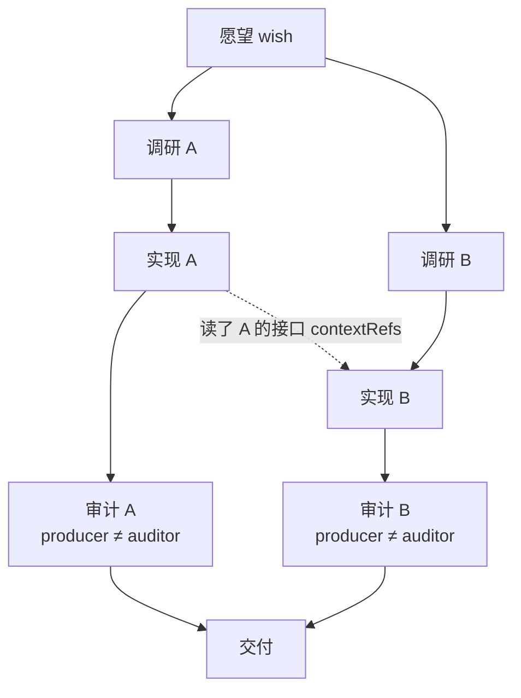

# AI集群工作协议 · DSH 千级agent实例集群工作插件

一个**许愿式集群工作插件**，不是普通单 Agent 工具：

- 你提交一个愿望，插件把愿望记录为意图，由 AI 按需求组装**工作图**（节点与依赖由工作决定，不是固定流水线）；
- 按工作图**派发多个子 Agent 并行工作**，子 Agent 可以继续向下递归派发，形成分支工作树；
- 每个节点走「领取 → 证据 → 独立审计 → 完成」，审计方不能是生产方；
- 相当于同时开很多个执行载体一起推进同一个任务，换来更高的并行吞吐。

## 这不是多 agent 角色编排

**本系统不是多 Agent 角色个体编排。** 它的四个构成物是：

| 要素 | 是什么 |
|---|---|
| **工作图** | 由**组成因子现场生长**出来，不是预先写死的流水线 |
| **载体** | 一群**流过图节点的、无身份的**执行载体 —— 没有固定角色，谁流过谁干活 |
| **能力** | 随每一步流程**借出又收回**的能力片段，不是常驻绑定 |
| **哈希链** | 把这一切串起来的那条线，**断了就响亮失败**（`STATE_HASH_BREAK` / `STATE_SEQ_GAP`），不给「看起来正常」的中间态 |

**集群是唯一的主体，实例是它的瞬时投影。**

设计集群实例为**千级**（**未实跑千级agent协作任务验证** —— 需要一个足够复杂/庞大的任务；实际任务拆解是按需才增加的，不是一开始就铺满）。集群**权限是浮动的**，同样由工作图派发：需求、任务、能力、权限都来自图，不挂在某个实例身上。

**审计是在工作编排流程上让另外实例走的** —— 不是在事后人工抽查。

> **这是有意设计，不是漏掉的缺陷。** 单个或几个人类大概**审计不了上千实例**，
> 或者审计速度跟不上集群的协作。所以审计必须成为流程的一部分，由结构保证，而不是靠人盯。



节点与依赖由愿望决定，不是固定流水线；同一张图里横向可以并行，纵向必须等上游 `done`。

## 装

```text
plugin_manager install_bundle({ target: "<解压路径>/dsh-l0-control" })
plugin_manager install_bundle({ target: "<解压路径>/dsh-l0-control-ui" })
```

**前置条件两件，缺一件就跑不起来**：

1. **DSH 宿主** —— 这是宿主插件，没有宿主无法独立运行；
2. **启用 `agent-team`** —— profile 里加上 `@deepseek-ai/dsh-experimental-agent-team`（见 [宿主依赖](plugins/dsh-l0-control/README.md)）。

不启用 `agent-team` 也能跑（图 / 租约 / 证据 / 审计 / 协调器都正常），但 `agent_spawn` 会**全部退回 activation**，派出的实例不能当 TeamTask owner。

装之前先跑一次环境体检：

```text
env_check    # ready、宿主服务、各盘空间、按实测速率推算的规模上限
```

## 代价先说清楚

**它非常消耗 token。** 递归/并行成倍放大成本；每个子 Agent 都是独立上下文与完整模型调用。启用前请设预算、控制 `maxParallel` / `maxDepth`，不需要时保持停用。

量级：`maxParallel × 每轮上下文`，**线性放大**。1000 个节点在默认感知配置下约多花 60–80 万 token（[编排感知](docs/12-agent节点编排感知.md) 第三节）。

> **文档分工**：本文件只写**架构、用法与现状**。按功能模块展开的细节在 [`docs/`](docs/README.md)
> ——状态与日志 / 派发与闸门 / 租约 / 证据与审计 / 协调器 / 容量 / 存储 / 工具 / 测试 / 质量 / 协作图 / 编排感知，各一篇。
> 「为什么做这个」在 [docs/13](docs/13-为什么做这个.md)。
> 按轮次的改动记录与踩坑统一在管理区 `reports/`。工程区不放流水账。

---

## 架构

### 一、单一事实源：工作图 + 哈希链 journal

节点、依赖、租约、证据、阶段闸门全部由**事件日志折叠**得出，不做第二份状态。日志是哈希链的（`seq` / `prevHash` / `hash` 逐条相接），因此：

- **可回放**：重启后从 journal 重建状态，不依赖任何快照的正确性（快照只是加速器，锚点校验失败就退回重放）；
- **可校验**：链一断立刻报 `STATE_HASH_BREAK` / `STATE_SEQ_GAP`，不给"看起来正常"的中间态；
- **不可静默截断**：`submitted` 与 `verified` 是两种不同的东西，前者只有产物、后者才有结论。

### 二、两本账

| 账本 | 内容 | 用途 |
|---|---|---|
| **N4 哈希链 journal** | core 事件（节点/租约/证据/闸门/决策） | 权威状态源，可校验、可回放 |
| **N3 扁平日志** | 派发登记、tick、闸门归因、访问审计 | 回答"刚才为什么没派"，不参与状态推导 |

两本账各写各的，但**同一件事必须两边都落**——只回收租约不写派发登记，节点会「重新可就绪、却再也不会被派出去」。

### 三、租约与身份分离

`task_claim` 发的是**租约**，带一个单调递增的 `fencing_token`。它的语义是**能力凭证，不是身份**：

- 任一载体持当前 token 即可续租/提交，换载体旧 token 立刻失效（`assertFencing`）；
- 续租失败 = 停手信号，不是"稍后重试"；
- 过期租约不会被"悄悄续成新 token"——必须先 `expire` 或 `takeover`，这条契约是**故意**保留的。

### 四、证据与审计

- **证据必须对应真实产物**：`acceptance` 由插件对磁盘上的文件机器判定（`exists` / `sha256` / `contains`），判定不了就是 `unknown`，**绝不当 pass**；
- **来源分级**：`verified` / `inferred` / `assumed`，只有 `verified` 能支撑节点完成。显式传 `acceptance` 且命中即 `verified`；只有手写结论的是 `inferred`；
- **审计结构性独立**：`producer_instance ≠ auditor_instance`，且审计方职务必须在 `[AUDIT, AUDIT_CODE, AUDIT_EVIDENCE, AUDIT_DESIGN]` 里。审计身份**只能由调用者本身决定**——`producer_instance` 是被审计对象，把它当调用者会让合法审计被判自审。

### 五、就绪是推出来的，不是轮询出来的

`deps` 全 `done` → 节点 `ready`，由事件驱动推进，并对就绪集合做缓存（`epoch` + `state` 身份双键，任何状态迁移/增删/依赖变更都失效）。既保证"改了就失效"，也避免每次问活都扫全图。

### 六、闸门是一条优先级链

派发计划按固定顺序拦截，**每项跳过都带 `gate` 字段说明是哪一道挡的**，并给出"该调哪个参数"：

```
巡检/防重放 > 预算 > 宿主退避 > 分区满员 > 四道限流（tick / 容量 / 速率 / 排队）
```

关键区分：**容量**是我们的并发上限（调 `maxParallel` 有效），**宿主退避**是宿主的额度（调本插件任何参数都无效）。两者混成一个"满了"，运维就会去调错的旋钮。

### 七、常驻协调器

一个确定性维护循环（默认 30s），**不派活**，只做两件事：

1. **reap**：回收过期租约 + 清扫「`submitted`/`verifying` 但没有租约」的孤儿（不处理会永久卡死：不能领、不能验、唯一出口不可达）；
2. **审计路由**：节点 `submitted` 超时仍无人验 → 自动派审计实例。

全部是状态机规则、幂等、可断言，每轮写 `coordinator_tick`。**没有 Lead caller 时只 reap、不派审计**——不猜、不降级成别的身份乱派。

### 八、journal 分段

单文件有**物理**上限：`readFileSync` 要建字符串，V8 `MAX_STRING_LENGTH` 是 512 MB，实测 512 MB 直接 `ERR_STRING_TOO_LONG`。真实 journal 约 528 B/行 ⇒ **约 102 万行（≈50 万节点）就到顶**。

分段策略：**活动段永远是 `journal.jsonl`**，封存段是 `journal.0001.jsonl`…。老版本只认活动段，滚动后读到的是从中间开始的 `seq` → 直接 `STATE_SEQ_GAP` **响亮失败**；反过来若让活动段带段号，老版本只会读到一个合法前缀、安静地少看一半历史——那是最坏的一种"看起来正常"。

---

## 协作结构

一张图说清「从许愿到 done」谁在干什么，以及「千」在这套结构里被哪几个点限制。

```
Lead（发起对话的会话）
  │  wish_submit(text)           只记愿望，不建图
  │  graph_plan(spec)            零写入预览：ID 唯一/依赖存在/无环/阶段合法/可验收/预算合法
  │  graph_commit(spec)          校验通过才落图；重复提交幂等，失败零写入
  ▼
[工作图]  nodes[]（deps / stage / acceptance / evidenceRequired / verifierIds / budget）
          + policies{maxParallel, maxDepth, budgetTokens}
          + coordination{partitions[]：maxActive / budgetTokens / writeScopes}
  │
  │  就绪是**事件驱动**推出来的：deps 全 done → ready（不是轮询）
  ▼
┌──────────────────────── 派发（两条路径，同一套闸门）────────────────────────┐
│ 手动：Lead 自己 task_next → task_claim → 自己做 / 或 agent_spawn 派出去      │
│ 自动：dispatch(mode=interval|resident, enqueue:true) → 定时 tick            │
│        tick 内按优先级拦截 → 每个候选一次 agent_spawn                       │
└────────────────────────────────────────────────────────────────────────────┘
  ▼
worker（真 session，**自驱**）
  task_next → task_claim     准入四道：分区容量 → 全图容量 → 速率 → 预算
                            通过则发租约（owner + fencing_token 单调 + TTL）
           → task_heartbeat  续租；不续 = 到期被回收，节点回到 ready
           → 写产物
           → evidence_submit acceptance 由插件对真实产物机器判定 → verified / inferred
           → pass_gate       五段闸门：research / design / build / audit / deliver
           → verify_done     要求：证据 verified + 审计独立 + 依赖全 done + 闸门 passed
  ▼
done（必须铸出 done 凭证才能进；终态不可退出）

维护（常驻，不派活）：coordinator tick → reap（过期租约 + 孤儿）+ 审计路由
```

结构上的四个特征：

1. **没有「调度 Agent」**。派活是插件按 journal 推导的**确定性决策**，不是某个 LLM 在分配任务——所以可复现、可解释。
2. **worker 自驱，插件不代领**。插件只负责 spawn；`task_claim` 是 worker 自己的动作。
3. **身份与权限分离**。`fencing_token` 是能力凭证，不绑身份。
4. **审计结构性独立**。`producer ≠ auditor`，且审计职务有白名单。

**组织能力在图内按需生长，不设常驻经理 Agent：**

- 组成因子声明组织意图（`coordination.organization.integrationContracts`：哪些节点完成后必须做跨节点集成、按什么验收）；不声明就不插入协调节点。
- `organization_review` 只读地把冲突、契约状态、写域重叠投影成报告，附 `fingerprint`（同一 journal 重放出同一值）；**发现 ≠ 裁决 ≠ 重规划**。
- 冲突只出**草案**（`proposals`），采纳必须显式 `graph_replan` 并带 `expectedGraphVersion` 做 CAS——旧草案不得覆盖新图，版本不符直接 `replan_stale_graph` 且零写入。
- 语义裁决不下放给协调器：技术契约矛盾交临时协调/审计节点，价值取舍交给人；没有承接能力时是 `capability-gap`，**不静默回退到 CODE**。

设计取舍与未做项在 [14 组织因子与协调闭环](docs/14-组织因子与协调闭环设计.md)。

「千」在这五个点上被限制：

| 限制点 | 配置 | 归属 |
|---|---|---|
| 同时活的租约 | `maxParallel` | 本插件 |
| 分区内并发 | `coordination.partitions[].maxActive` | 本插件 |
| 每秒新派 | `dispatchRatePerSecond` | 本插件 |
| 已派未领的积压 | `maxQueuedTasks` | 本插件 |
| **宿主 Team 成员数** | `teamMemberLimit`（默认 256） | 宿主 `agentTeams.maxMembers`，启用协作时自动放开 |
| **宿主子会话并发数** | `subagentMaxActive`（默认 256） | 宿主 `subagents.maxActiveSubagents`，同上 |

最后两层不归本插件管，但都是 Cordis 配置项、且插件会在启用协作时自动抬到上面的值——**不抬这两层，`maxParallel` 配多大都没用**。

---

## 设计要点

几条贯穿全仓的纪律（细节与代价见管理区各轮报告）：

- **fail-closed 优先于"能用"**。读半截要响亮失败，不安静降级。宁可 `STATE_SEQ_GAP` 也不给合法前缀。
- **幂等优先于增量记账**。每轮重算应有状态、做差集，而不是依赖上一轮的记忆。
- **不越权**。没有 Lead caller 时协调器只做无需身份的事；审计身份只能由调用者本身决定。
- **同一件事只有一个入口**。状态迁移一律经 `setStatus`，改图一律经 `graph_replan`；建成第二条路，两条必然漂移。
- **改图要带版本**。`graph_replan` 缺 `expectedGraphVersion` 直接拒——旧草案覆盖新图，是最难复现的那种错。
- **实测优先于推断**。数字未经实测不宣称达标；单点变快不可信，**跨规模持平才可信**。
- **区分"我们的旋钮"与"别人的额度"**。前者调参数有效，后者调什么都没用——混在一起就是给错的建议。

---

## 性能与容量现状

控制面（本插件自身）：

| 指标 | 实测 |
|---|---|
| 每节点成本 | **6.8 ms**（claim + 证据 + 验证 + 心跳） |
| 1000 → 2000 节点 | 比值 **1.01×**（不再随规模增长） |
| 10 万节点冷启动 | **0.087 ms/节点** |
| journal 单文件上限 | 512 MB ≈ 102 万行 ≈ 50 万节点（已分段） |

真 Agent 侧（实测样本，非分布）：

| 项 | 实测 |
|---|---|
| spawn → claim | 10.72 s（4 步流水）/ **1.76 s**（只要求一次 claim） |
| claim → submitted | 6.28 s |
| 宿主子会话并发（本机） | **32 稳 / 54 崩**：32 个持锁会话跑满全程（32/32、报错 0）；加到 54 时宿主 `dsh-experimental-inspector` 抛未捕获异常、host 退出（**不是内存，也不是本插件**） |

**不宣称**：以上「插件侧」数字只证明插件不是瓶颈，不代表千 Agent 端到端能力。LLM 吞吐、宿主 session 上限、token 预算真实性、网络均未在千级规模实测。

「N 个会话同时活」的测法：`artifacts/calib/conc32`——每个子会话自己把 `start`/`end` 两个时间戳写盘、中间 `Start-Sleep` 持锁，再对所有区间打点求同时存活的峰值（32 那档：**峰值 32，`active child limit` 报错 0 次**）。它证明槽位能占满，不证明 token 吞吐跟得上——持锁期间这些会话是阻塞在一次工具调用上，不是各自跑满推理。

**54 那档的结论更值得记**：宿主 `dsh-experimental-inspector` 在 50 上下会因 `source state exceeds the source-frame byte limit` 抛未捕获异常、把整个 host 带走（崩时内存还剩 3–4 GB）。也就是说**「千级」当前的卡点不是本插件、不是内存，是宿主 inspector**；要到 256 得先摘掉这条路径。详见 [06 容量与宿主依赖](docs/06-容量与宿主依赖.md)。

---

## 仓库结构

```text
plugins/dsh-l0-control/      控制面 Host 插件（core / state / native / security / observability / a2a / bootstrap）
plugins/dsh-l0-control-ui/   侧边栏 + 主面板（AI集群工作协议）
presets/memory-first/        记忆优先 Agent 预设
schema/                     工作图与作用域请求 schema
fixtures/                   schema 校验用例
tools/check_fixtures.py     对外：fixture 校验
tools/analyze-session.mjs   对外：会话返工分析（从 DSH 会话记录统计工具失败率与错误聚类）
tools/dev/                  开发期文档审计（乱码 / 断链 / 语言比例 / 语法残留）
examples/                   两目录协议的最小样本（工程区 + 管理区）
artifacts/                  worker 运行时产物（标定数据、复现脚本；非源码，不进版本库）
```

## 开发

**`lib/` 是入库的**——`main` 指向 `lib/index.js`，别人 clone 后不用构建就能安装。代价是**改了 `src/` 必须重新构建，否则仓库里的产物和源码不一致**：

```powershell
cd plugins/dsh-l0-control
node scripts/build.mjs          # src/*.ts → lib/*.js
node scripts/build.mjs --check  # 只校验同步性（CI 里跑这个）
```

`build --check` 会在 CI 里挡住「改了源码忘了构建」。这是刻意选的：把产物入库换来「拿到就能装」，就得用一道检查守住两者的同步。

**验收链**：

```powershell
npm run verify        # 62 步：契约、状态机、租约、证据、闸门、持久化、e2e、泄漏闸门
```

**分层原则**：`verify` 只断言语义，不断言速度——性能探针（`bench:*`）与规模演练（`sim:cluster`）单独跑，不进验收链。因为把时间断言放进 CI，要么被噪声打红，要么被人调宽松，两种都让这条链失去意义。

**测试写状态目录的硬要求**：`stateDir` 必须传**绝对路径**。service 会拿相对路径按 `workspaceRoot` 重新解释，于是状态落进源码目录、而清理钩子删的是另一个路径——本仓库曾因此攒下 611 个残留目录。`verify` 的最后一步是泄漏闸门（插件目录下出现非白名单目录就红），专门守这一条。

## 数据落点与容量

**开工前先看这一节。** 跑起来之后才发现盘满了，迁移成本远高于现在改一个环境变量。

### 三处落点

| 数据 | 落在哪 | 增长速率 | 可控 |
|---|---|---|---|
| **协作记录**（journal / 快照 / 证据） | **工作区下 `.l0-control/`** | journal 约 **4.2 KB/节点**；分段上限 512 MB（≈50 万节点） | ✅ 跟随工作区，`stateDir` 可配 |
| **每个 Agent 的会话** | **`$DSH_HOME/sessions/`** | **约 1–1.3 MB/会话** | ⚠️ **默认就在系统盘** |
| 测试/自检临时目录 | `os.tmpdir()` | 量小 | 可用 `TEMP` 改 |

`stateDir` 是相对 `workspaceRoot` 解析的，所以**协作记录天生跟随工作区**——工作区在数据盘，记录就在数据盘。

### 按规模算

会话数据是唯一会失控的部分（只增不减）：

| Agent 数 | 会话数据（按 1.29 MB/会话） |
|---|---|
| 100 | ≈ 0.13 GB |
| **1000** | **≈ 1.26 GB** |
| 10000 | ≈ 12.6 GB |

### 插件会提前告诉你

**开工前先调一次 `env_check`**。它把「能不能跑」的三件事一次问清，并给出能直接照做的结论：

```json
{
  "ready": true,                       // false 时看 blockers，那是必须先解决的
  "blockers": [],                      // 缺 subagents / 缺 agentTeams / 会话盘装不下千级
  "hostServices": { "ok": true, "present": ["agentTeams","subagents","sessionController"], "missing": [], "degraded": [] },
  "storage": {
    "ok": false,
    "systemDrive": "C:",
    "drives": [{ "root": "C:", "freeGb": 13.7, "totalGb": 123.1 },
               { "root": "F:", "freeGb": 191.8, "totalGb": 465.3 }],
    "locations": { "sessionDir": { "path": "C:\\Users\\…\\.dsh\\sessions", "drive": "C:", "sessions": 187, "sessionsMb": 242.1 } },
    "warnings": ["Agent 会话集中写在系统盘 C:（可用 13.7 GB）。实测 1.30 MB/会话 → 1000 个 Agent 约 1.27 GB…"],
    "advice": ["把 DSH 数据目录迁到更宽的盘（F: 现可用 191.8 GB）：setx DSH_HOME \"F:\\dsh-home\"…"]
  },
  "scale": {
    "perAgentMb": 1.3,                 // 实测，不是拍的常数
    "perNodeJournalKb": 4.2,
    "for1000AgentsGb": 1.27,
    "for10000AgentsGb": 12.66,
    "suggestedMaxAgents": 5395         // 按会话盘可用空间反推这台机器实际能跑多少
  }
}
```

启用协作后**首次工具调用**还会自动跑一次，写进 journal（`storage_ok` / `storage_tight`，只写一次），所以不调 `env_check` 也不会漏。

**告警阈值刻意保守**：只在「会话在系统盘」且（可用 < 20 GB **或** 千级预估 > 可用 30%）时才喊，避免对「小项目本来就在 C 盘」天天误报。

### 迁走会话数据

`DSH_HOME` 是**宿主环境变量**，插件不会偷偷改它（改了要重启，且影响所有 profile）：

```powershell
# Windows（用户级，重开 DSH 生效）
setx DSH_HOME "F:\dsh-home"
# 迁移前先把旧目录内容搬过去：
#   C:\Users\<你>\.dsh  →  F:\dsh-home

# macOS / Linux
export DSH_HOME=/data/dsh-home
```

改了之后 `sessions` / `profiles` / `dsh-runtimes` 整体跟着走。**这是唯一能一次性根治的办法**——只做目录联接（junction）DSH 不保证认。

### 清理

- **旧会话**：`$DSH_HOME/sessions/<工作区>/` 下按需删（删掉的是历史对话，不影响工作图与证据）
- **协作记录**：journal 会分段（`journal.jsonl` 是活动段，`journal.0001.jsonl`… 是封存段），旧段可归档到别的盘；**别删活动段**
- **`node_modules`**：只在想改代码时才需要（`npm install`），安装插件本身**零运行时依赖**

---

## 成本与适用场景

- **适合**：工作量大、可拆分并行、需要独立审计/交叉验证的任务。
- **不适合**：小任务、低预算、必须严格串行或对延迟敏感的任务。
- **成本口径**：并行 Agent 数量 × 每轮上下文 × 递归深度。
- **建议**：先用小愿望试运行，设置 `maxParallel` / `maxDepth` 与 token 预算，观察 `graph_status` 的观测字段后再放大。

## 作者与许可

- **制作者**：weidujianchazhe（如天之星）
- **许可证**：MIT License，见 [LICENSE](LICENSE)
- 可自由使用、修改、分发、商用，需保留版权与许可声明；软件按「原样」提供，不附带担保。

## 安装

在 DSH 中通过 `plugin_manager install_bundle` 安装两个插件目录：

```text
plugins/dsh-l0-control
plugins/dsh-l0-control-ui
```

**部署注意**：包内 `cordis.patch.yml` 不写死 `workspaceRoot`；默认使用 DSH 的 `workingDirectory.defaultDirectory`，状态落在该目录的 `.l0-control/`。多工作区/独立状态请在 profile 里显式覆盖 `workspaceRoot` 与 `stateDir`，不要依赖进程 cwd。

**真正生效的配置在 profile**（`~/.dsh/profiles/<name>/cordis.patch.yml`），插件自带的 `cordis.patch.yml` 只是安装初始值。

### 依赖的宿主服务（有一条不在本仓库里）

本插件的 `inject` 只有 `['tools']`，其余能力全是运行时从宿主取的。**缺了不会报错，但会静默降级**——所以插件会在首次工具调用时自检一次，缺什么写清楚：

| 宿主服务 | 谁来提供 | 缺了会怎样 |
|---|---|---|
| `subagents` | DSH 内置核心服务 | **完全派不出子会话** |
| `sessionController` | DSH 内置核心服务 | 无法续跑既有会话、无法转发消息 |
| `agentTeams` | **`@deepseek-ai/dsh-experimental-agent-team`（DSH 自带，但要在 profile 里启用）** | `agent_spawn` 全部退回 activation（子实例**不能**当 TeamTask owner），`teamMemberLimit` 自动放开无效；**其余功能全部正常** |

**所以启用它**：在 profile 里加

```yaml
- id: agent-team
  name: "@deepseek-ai/dsh-experimental-agent-team"
  config:
    maxMembers: 256
```

不加也能跑——图、租约、证据、审计、协调器、`subagentMaxActive` 那些都不依赖 Team。但只要你想让派出的子实例**能当 TeamTask owner**（审计路由派出的审计实例就属于这种），就必须启用它。

**怎么确认**：`graph_status` 的 `capabilities.hostServices` 会直接告诉你。

```json
"hostServices": { "ok": false, "present": ["subagents","sessionController"],
                  "missing": ["agentTeams"], "degraded": ["agent_spawn 将全部退回 activation…"] }
```

第一次工具调用时还会往 journal 写一条 `host_service_missing`（只写一次）或 `host_services_ok`。**不用再从返回值里倒推。**

## 主要能力

- **愿望 → 工作图**：`wish_submit` 只记录意图；`graph_plan` 零写入校验预览；`graph_commit` 落图（幂等，校验失败零写入）。
- **派活与租约**：`task_next` / `task_claim` / `task_heartbeat`。心跳绑定 `fencingToken` 能力凭证而**不绑定智能体身份**；续租失败即停手。
- **证据与审计**：`evidence_submit`（产物须真实存在，带来源分级，仅 `verified` 能支撑完成）、`verify_done`（生产方与审计方必须不同）、`pass_gate`。
- **子 Agent**：`agent_spawn`（三种组装策略，Team 满自动退 activation）、`agent_message`、`agent_reap`（默认 dry-run）。
- **维护**：常驻 `coordinator`（reap + 审计路由），可手动调 `coordinatorTick`。
- **记忆优先**：`memory_load` / `memory_writeback`；启用协作的对话默认只保留最近 30 轮上下文。
- **可观测**：面板显示团队、活跃子 Agent、就绪节点、黑板事件；`graph_status` 支持分页。
- **开工前体检**：`env_check` 一次给出宿主服务、数据落点与各盘空间、按实测速率推算的千级/万级占用，以及 `suggestedMaxAgents`（这台机器实际能跑多少）。

## 门禁

```powershell
node plugins/dsh-l0-control/scripts/build.mjs --check      # 构建产物与 src 同步
node plugins/dsh-l0-control/scripts/typecheck.mjs          # 类型检查（0 error）
node plugins/dsh-l0-control/scripts/selftest.mjs
node plugins/dsh-l0-control/scripts/contract.mjs
node plugins/dsh-l0-control/scripts/bootstrap-check.mjs
node plugins/dsh-l0-control/scripts/persistence-check.mjs
node plugins/dsh-l0-control/tests/e2e/conformance.mjs
node plugins/dsh-l0-control/tests/e2e/run.mjs
```

完整验收链：`npm run verify`（62 步）。性能探针与规模演练**不在验收链里**（`bench:*` / `sim:cluster`）——断言语义，不断言速度。

## 按对话启用

插件默认 `coordination=false`、`management=off`。在面板「插件开关」启用协作；「项目管理」里单独设置工作区管理（关闭 / 自动 / 开启）。

**启用协作会同时做两件事**：抬宿主 `agentTeams.maxMembers` 与 `subagents.maxActiveSubagents`（默认都到 256）。不抬这两层，派发会被宿主以 `TEAM_MEMBER_LIMIT` / `active child limit` 挡住。

## 面板侧车

面板数据来自插件内置的只读侧车（默认 `127.0.0.1:47831`，可用 `uiHost` / `uiPort` 调整）。
跨源访问按**来源主机**判定：回环来源（`127.0.0.1` / `localhost` / `[::1]`）任意端口放行，
外部站点一律拒绝；如需反代或自定义域名，用 `uiAllowedOrigins`（逗号分隔）显式追加。

## 检查更新

`updateRepo` 默认 `weidujianchazhe/ai-cluster-protocol`，读取本仓库 `plugins/dsh-l0-control/package.json` 的 version 做比较；只有点击「检查更新」才请求，不自动更新。

