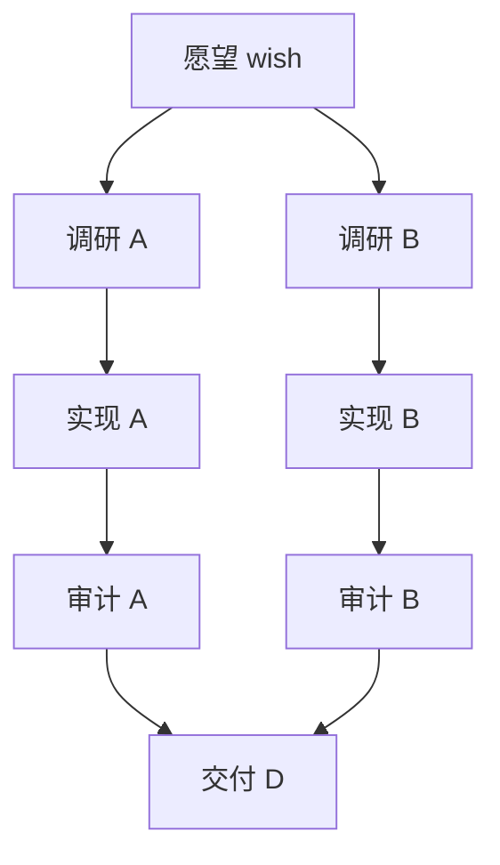

# A1 · MoE 专家编排猜想

> **附录编号**：`A1`/`A2` 不占正文 `01`–`14` 的递归序列——正文讲「怎么运作」，附录放「猜想」与「已知问题台账」。

> **能不能把外部多 agent 编排，内化成模型内部的 MoE 式专家路由？**
>
> 这篇是**留档**：猜想从哪来、为什么诱人、技术边界在哪、以及——最容易被忽略的——
> **就算做到，它换来的也不是效率。**
>
> 写它的目的不是"将来要做"，而是**说清哪些方向不必再想**，
> 以及**能力边界到底卡在哪一层**。

## 一、猜想的来源

做完 ①②③（质量度量 / 因果标注 / 编排感知）之后，很自然会问：

> 外部的多 agent 编排——`deps` 决策 → 派发 → 独立上下文 → journal 汇总——
> 如果内化成模型内部的 MoE 式专家路由，会不会更强？

直觉很吸引人：

> **同一个推理过程里，多个"专家"并行处理同一工程的不同部分，输出汇聚成一个完整产物。**

这也是很多人对"真正的集群智能"的想象：**内部多口输出，服务同一个完整工程的不同工作**。

## 二、MoE 实际是什么

```
token → router（可微 gate）→ top-2 专家 → 加权求和 → 同一个 hidden state
```

三个必要特征：

| 特征 | 含义 |
|---|---|
| **路由是学出来的** | router 有权重，梯度从 loss 反传到 router |
| **输出在同一空间加权** | 所有专家输出同一维度的向量 |
| **目标统一** | 全部服务于「预测下一个 token」 |

## 三、与本协议的错位：五维对照

| 维度 | MoE | 本协议 | 能否弥合 |
|---|---|---|---|
| **路由** | 学出来的（可微 gate，梯度反传） | 写死的（`deps` 全 done → ready） | ❌ 我们无梯度，质量分只能观察不能优化 |
| **表示** | 共享（同一 hidden state，可加权求和） | 不共享（每个 worker 独立上下文 + 文本产物） | ❌ 文本接口到不了 hidden state |
| **目标** | 统一（预测下一个 token） | 每节点不同（各有 `spec`） | ⚠️ 只有 `wish` 层面统一 |
| **失败** | 不存在"专家 3 算错了" | 失败是一等公民（`rejected` 阻塞下游） | ❌ 语义根本不同 |
| **成本** | 一次前向内 | `maxParallel × 每轮上下文` | ❌ 量级不可比 |

**结论：内化成 MoE 不是优化，是换一个不同的问题。**

MoE 解决"单次前向怎么用更多参数"；本协议解决"多个独立工作怎么组织"。**它们不在同一层级。**

## 四、如果真的往那个方向走，它优化的是什么

这一条比技术边界更重要，也是最容易被误读的地方：

> **它优化的绝对不是性能，也不是让更多人用。**

具体说：

| 它 **不** 优化 | 它 **会** 增加 |
|---|---|
| 推理速度 | **算力占用**（多口并行 → 更多前向） |
| 单次任务成本 | **资源门槛**（能用得起的人更少） |
| 设备需求 | —— |
| 单位算力产出 | —— |

**它唯一优化的是一件事**：

> **一个大模型能不能完成更庞大、更加复杂的工程。**
>
> 也就是**单个 agent 即便有百万级（一兆）上下文，也难以直接实现的能力**。

这是"**能力上限**"的扩张，不是"效率"的提升。而且这种扩张**必然以更多算力为代价**——它是**收缩性**的优化（服务少数要完成超大工程的场景），**不是普惠性的**。

### 所以判断标准该换

判断一个"内部 MoE 化"方案值不值，不该问「快了多少」，该问：

> **它让原本做不了的哪一类工程变得可做了？**

**如果答不出这句，那这个改造只增加了成本。**

## 五、三条不能撞的墙

| 墙 | 具体是什么 |
|---|---|
| **没有梯度** | 质量分（`quality_report`）是**过程指标**，不可微。要"会学的路由"，先得让质量信号能反传，而它现在连优化入口都没有 |
| **没有共享表示** | worker 之间是文本接口。要内化，先得有"节点产物的向量表示" + 跨节点对齐，成本极高且不稳定 |
| **失败语义不同** | MoE 里"专家表现差"是连续的、自动降权的；本协议里"节点失败"需要人/审计判定，且**阻塞下游** |

## 六、各层能触及什么

| 层 | 谁负责 | 能否触及 |
|---|---|---|
| token → 专家路由 | 模型内部（MoE/router） | ❌ 完全碰不到 |
| 上下文窗口内的推理 | 模型自己 | ❌ 只能通过 prompt 间接影响 |
| **会话之间怎么分工** | **本协议** | ✅ 这是唯一作用层 |
| **会话之间怎么传信息** | **本协议** | ✅ journal / evidence / `contextRefs` |

**①②③ 全部作用在"会话之间"。** 它们不提升单会话能力，只提升多个会话协作的**可观测性**与**可组织性**。

这个边界不该去撞——它是**层级事实**，不是"还没做完"。知道它，比做完它更有用：**它能省掉一整类注定徒劳的尝试。**

## 七、本协议已经做到的"多口输出"

用户设想里有一个部分**已经成立**：

> 多口输出，服务同一个完整工程的不同工作。

这正是当前的工作图：



- **目标统一**：全部服务于同一个 `wish`；
- **多口并行**：同一依赖深度上的节点可以同时跑；
- **汇聚**：`D` 依赖全部上游 `done`。

**唯一和 MoE 不同的，是这些"专家"不共享表示空间**——它们的产物是文本、代码、JSON，不是向量。

所以准确的说法是：

> **我们是"多口输出、服务同一目标"，但不是"在同一表示空间里加权"。**

## 八、留档理由

这个猜想的价值不在于将来要不要做（大概率不做），而在于三件事：

1. **说清了能力上限在哪** —— 再多的编排创新也到不了推理内部；
2. **说清了优化方向该往哪问** —— 问"能做多大的工程"，别问"能快多少"；
3. **说清了代价** —— 任何"让模型一次处理更大工程"的方案，都会**增加**而不是降低算力占用。

**最后一条最容易被忽略**：这类改造听起来像"变强了"，实际是"变贵了"——它把门槛抬高，把可服务的场景收窄。

如果哪天有人拿"内部 MoE 化"当卖点，先问上面那句：**它让哪类工程从"做不了"变成"做得了"？**

---

**相关**：[12 编排感知](12-agent节点编排感知.md)（本协议的感知层能做到什么）· [13 为什么做这个](13-为什么做这个.md)（这套编排的由来与代价）
